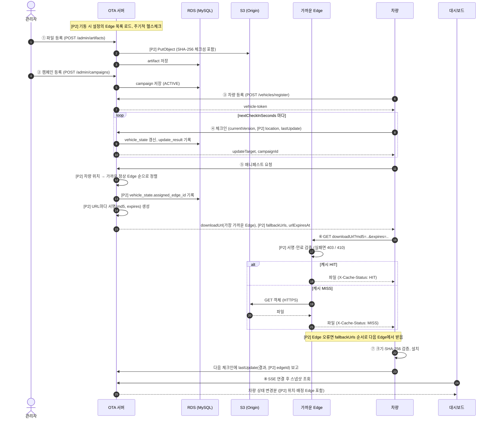
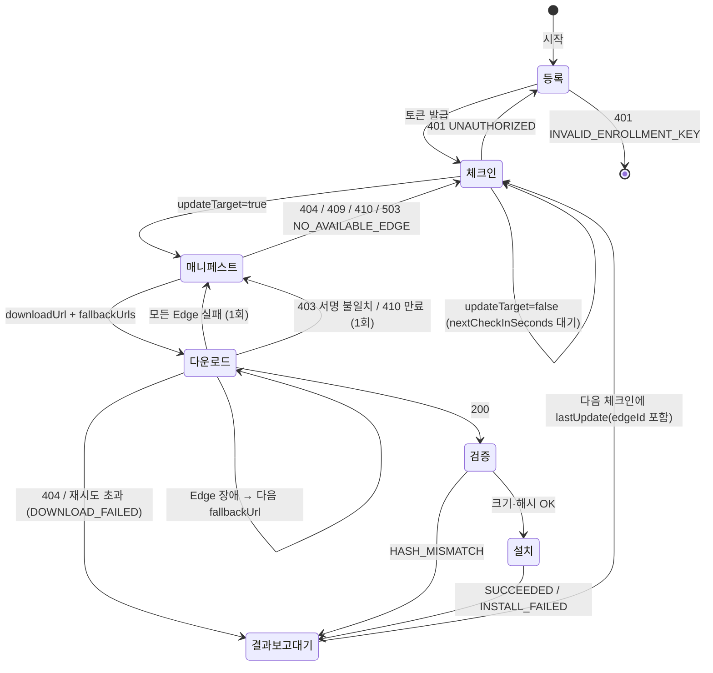

# OTA 전체 흐름 (Phase2)

- 상태: 설계중 (v2)
- 작성일: 2026-10-28
- 핵심: **CDN Edge를 여러 개 두고, 차량 위치에서 가장 가까운 Edge에서 업데이트 파일을 받는다.** 새로 추가되거나 바뀐 곳은 `[Phase2]`로 표시했다.

## 0. 등장 주체

| 주체 | 역할 |
|---|---|
| 관리자 | 업데이트 파일 등록, 캠페인 등록 |
| OTA 서버 | 파일 메타데이터·캠페인·차량 상태 관리, 대상 판정, **[Phase2] 가까운 Edge 선택, 서명 URL 발급**, 매니페스트 발급, SSE 전송 |
| Origin (**[Phase2] AWS S3**) | 업데이트 파일 원본 저장소. Edge가 MISS일 때 HTTPS로 가져간다 |
| CDN Edge (nginx Pod) | **[Phase2] 지역별로 여러 개. 서명 URL 검증.** 차량에 파일 배포, 캐시 미스면 Origin에서 가져옴 |
| 차량 | 등록, 주기적 체크인(**[Phase2] 위치 포함**), 다운로드·검증·설치, 결과 보고 |
| 프론트엔드 | 대시보드 (스냅샷 + SSE) |
| DB (**[Phase2] AWS RDS for MySQL 8**) | 기존 테이블 (**[Phase2]** 위치·Edge 컬럼 추가, §4) |

### Edge 구성 (클러스터 안)

```text
                         ┌─▶ cdn-edge-seoul   (NodePort 30081, 좌표 37.56, 126.97) ─┐
차량 ──다운로드(가까운 곳)──┼─▶ cdn-edge-daejeon (NodePort 30082, 좌표 36.35, 127.38) ─┼─MISS(HTTPS)─▶ S3 버킷 (Origin)
                         └─▶ cdn-edge-busan   (NodePort 30083, 좌표 35.18, 129.07) ─┘        ▲
                                                                                        │ PutObject
차량 ──체크인·매니페스트──▶ OTA 서버 Pod ───────────────────────────────────────────────────┘
                                │
                                └──▶ RDS (MySQL 8)
```

- Edge 하나 = nginx Deployment 하나 + Service 하나. Edge마다 고유 주소(`baseUrl`)와 대표 좌표를 가진다.
- Edge Deployment 안의 Pod 여러 개는 같은 Edge로 본다. Pod 장애는 k8s readiness가 처리하고, OTA 서버는 Edge 단위로만 선택한다.
- 같은 클러스터 안이라 실제 네트워크 거리 차이는 없다. **위치 기반 선택 로직과 Edge 장애 시 전환을 검증하는 모사 구성이다.**

### Edge 목록 (사전 정의)

Edge 목록은 **배포 전에 정해 두고** OTA 서버 설정(ConfigMap → `application.yml`)으로 넣는다. 관리자 API나 DB 테이블로 관리하지 않는다.

```yaml
orbit:
  cdn:
    default-edge-id: edge-seoul      # 위치를 모를 때 쓰는 Edge
    fallback-count: 2                # fallbackUrls 개수
    location-max-age: 10m            # 이보다 오래된 위치는 쓰지 않음
    signed-url-ttl: 1h               # 서명 URL 유효 기간 (서명 비밀 값은 ConfigMap이 아닌 Secret, §5)
    edges:
      - id: edge-seoul
        name: 서울
        base-url: http://192.168.100.102:30081
        latitude: 37.5665
        longitude: 126.9780
      - id: edge-daejeon
        name: 대전
        base-url: http://192.168.100.102:30082
        latitude: 36.3504
        longitude: 127.3845
      - id: edge-busan
        name: 부산
        base-url: http://192.168.100.102:30083
        latitude: 35.1796
        longitude: 129.0756
```

- 서버는 시작할 때 목록을 읽어 메모리에 둔다. `id` 중복, 좌표 범위(`-90~90`, `-180~180`), `default-edge-id`가 목록에 없음 → **서버 기동 실패**로 잘못된 설정을 바로 드러낸다.
- Edge 추가·삭제·좌표 변경은 orbit-gitops의 ConfigMap과 Edge Deployment/Service를 함께 고쳐 배포한다 (서버 재시작으로 반영).
- 운영 중 특정 Edge를 빼는 것은 설정 변경이 아니라 헬스체크(§2 ⑤ 아래)가 처리한다. Edge Deployment를 0으로 줄이면 헬스체크 실패로 자동으로 빠진다.

### [Phase2] AWS 저장소

| 항목 | 값 |
|---|---|
| Origin | S3 버킷 1개 (비공개). 객체 키 `firmware/{model}/{version}/firmware.bin` |
| S3 쓰기 | OTA 서버만. `s3:PutObject` 권한만 가진 IAM 자격 증명 |
| S3 읽기 | Edge만. 버킷 정책으로 Edge가 나가는 IP(`aws:SourceIp`)에만 `s3:GetObject` 허용 |
| DB | RDS for MySQL 8. 스키마·쿼리는 그대로 두고 `DB_URL`만 RDS 엔드포인트로 바꾼다 |
| 자격 증명 | IAM 키, DB 비밀번호는 코드·ConfigMap에 두지 않는다 (Secret 또는 Vault, §7) |

- 서버는 NFS에 쓰지 않는다. 기존 NFS·Origin nginx Pod는 쓰지 않는다.
- Edge가 S3를 직접 Origin으로 쓰므로 S3 요청에 서명(SigV4)을 붙이지 않는다. 그래서 버킷 정책의 IP 제한으로 Edge만 읽게 한다.
- Edge 캐시가 S3 요청 수와 S3 → 인터넷 전송량(비용)을 줄인다. 캐시 효과 측정은 기존 CDN 실험과 같은 방식으로 한다.

## 1. 전체 흐름



## 2. 단계별 흐름

### ① Origin 파일 등록 (관리자)

API는 그대로이고 저장 위치만 S3로 바뀐다. `POST /api/v1/admin/artifacts` · `multipart/form-data` · `Bearer {admin-token}`

1. 관리자가 `file`, `model`, `version`, (선택) `sha256`을 올린다.
2. 같은 `model + version`이 있으면 `409 ARTIFACT_VERSION_EXISTS` (S3에 올리기 전에 확인).
3. OTA 서버가 SHA-256을 계산한다. 요청에 `sha256`이 있으면 비교한다 → 다르면 `422 HASH_MISMATCH`.
4. **[Phase2]** S3에 `firmware/{model}/{version}/firmware.bin` 키로 올린다.
   - `ChecksumAlgorithm=SHA256`을 붙여 S3가 받은 내용도 같은 해시인지 검증하게 한다.
   - 큰 파일은 SDK의 multipart upload로 올린다.
   - S3 오류·타임아웃이면 `502 ORIGIN_UPLOAD_FAILED` (관리자가 재시도).
5. `artifact`에 저장하고 `201`로 `artifactId`, `fileSize`, `sha256`, `path`(`/firmware/{model}/{version}/firmware.bin`)를 돌려준다.

- 등록한 파일은 수정하지 않는다. 버전마다 새 키를 쓴다.
- S3 업로드는 됐는데 DB 저장이 실패하면 S3에 객체만 남는다. 같은 `model + version`으로 다시 등록하면 같은 키를 덮어쓰므로 정리하지 않아도 된다.
- `artifact.path`는 URL 경로(`/firmware/...`), S3 키는 앞의 `/`를 뺀 값이다.
- Edge에 미리 넣지(pre-warm) 않는다. 첫 다운로드에서 Edge별로 한 번 MISS가 난다.

### ② 캠페인 등록 (관리자)

`POST /api/v1/admin/campaigns` · `Bearer {admin-token}`

요청: `name`, `artifactId`, `targetVersion`, `target{model, hwVersions[], regions[], currentVersionMin, currentVersionMax}`, `startAt`, `endAt`

1. `artifactId`의 파일이 없으면 `404 ARTIFACT_NOT_FOUND`.
2. `target.model == artifact.model`, `targetVersion == artifact.version`, `startAt < endAt` → 아니면 `400 INVALID_INPUT`.
3. 같은 대상 조건 + 목표 버전의 활성 캠페인이 있으면 `409 ACTIVE_CAMPAIGN_EXISTS`.
4. 등록 즉시 `ACTIVE` → 바로 체크인 대상 판정에 반영된다.

- `target.regions`는 **배포 대상 지역(등록 속성)** 이다. Edge 선택에 쓰는 **차량 위치(좌표)** 와 다르다 (§6).

### ③ 차량 등록 · 토큰 발급 (차량)

`POST /api/v1/vehicles/register` · `Bearer {enrollment-key}`

요청: `vehicleId`, `model`, `hwVersion`, `region`, `currentVersion`

1. 등록 키가 틀리면 `401 INVALID_ENROLLMENT_KEY`.
2. `vehicle`을 만들거나 갱신(처음 `201`, 재등록 `200`), `vehicle_state.current_version` 갱신.
3. 기존 토큰을 `REVOKED`로 바꾸고 새 토큰을 발급한다. 토큰은 SHA-256 해시로만 저장하고 원문은 이 응답에서 한 번만 내려준다.

- 위치는 등록 때 받지 않는다. 차량은 움직이므로 체크인마다 받는다.

### ④ 체크인 · 대상 판정 · 결과 보고 (차량, 주기적)

`POST /api/v1/vehicles/{vehicleId}/check-in` · `Bearer {vehicle-token}`

요청

```json
{
  "currentVersion": "1.0.0",
  "location": { "latitude": 37.5665, "longitude": 126.9780 },
  "lastUpdate": {
    "campaignId": "cmp-20261028-001",
    "result": "SUCCEEDED",
    "failureReason": null,
    "failureDetail": null,
    "edgeId": "edge-seoul",
    "finishedAt": "2026-10-28T10:00:00Z"
  }
}
```

서버 처리
1. 경로의 `vehicleId`로 `vehicle`을 조회해 `model`, `hw_version`, `region`을 가져온다.
2. `vehicle_state`의 `current_version`, `last_seen_at`을 덮어쓴다.
3. **[Phase2]** `location`이 있으면 `vehicle_state`의 `latitude`, `longitude`, `location_updated_at`을 덮어쓴다. 없으면(GPS 미수신) 이전 값을 그대로 둔다. 좌표 범위가 틀리면 `400 INVALID_INPUT`.
4. `lastUpdate`가 있으면 `update_result`에 `(vehicle_id, campaign_id)` 기준으로 덮어쓴다(멱등). **[Phase2]** `edgeId`(실제로 받은 Edge)도 함께 저장한다.
5. 대상 여부를 판정해 응답한다. 위치는 판정에 쓰지 않는다.

응답

```json
{ "updateTarget": false, "nextCheckInSeconds": 30 }
{ "updateTarget": true, "campaignId": "cmp-20261028-001", "nextCheckInSeconds": 30 }
```

오류: `401 UNAUTHORIZED` → 등록부터 다시, `403 VEHICLE_MISMATCH`, `500` → 다음 주기에 재시도.

| failureReason | 상황 |
|---|---|
| `DOWNLOAD_FAILED` | 모든 Edge(`downloadUrl` + `fallbackUrls`) 실패, 크기 불일치, 재시도 초과 |
| `HASH_MISMATCH` | SHA-256 불일치 |
| `INSTALL_FAILED` | 설치 중 실패 |

### ⑤ 매니페스트 요청 · Edge 선택 (차량, 대상일 때)

`GET /api/v1/vehicles/{vehicleId}/campaigns/{campaignId}/manifest` · `Bearer {vehicle-token}`

1. 대상 여부를 다시 확인한다. 판정 순서 `404 CAMPAIGN_NOT_FOUND` → `410 CAMPAIGN_INACTIVE` → `409 NOT_UPDATE_TARGET`.
2. **[Phase2] Edge 선택**
   1. 설정의 Edge 목록 중 헬스체크가 정상인 Edge만 후보로 둔다.
   2. `vehicle_state`의 마지막 위치와 각 Edge 좌표의 거리(Haversine, km)를 계산해 가까운 순으로 정렬한다.
   3. 첫 번째 Edge로 `downloadUrl`을, 다음 Edge들(최대 `fallback-count`, 기본 2)로 `fallbackUrls`를 만든다.
   4. 위치가 없거나 너무 오래됐으면(`location_updated_at`이 `location-max-age` 초과) 기본 Edge(`default-edge-id`)를 첫 번째로 두고, 나머지는 설정 순서대로 둔다.
   5. 후보가 하나도 없으면 `503 NO_AVAILABLE_EDGE`. 차량은 다음 체크인에 다시 시도한다.
3. **[Phase2]** 고른 Edge를 `vehicle_state.assigned_edge_id`에 기록한다 (대시보드에서 차량별 배정 Edge 표시용).
4. **[Phase2] 서명 URL 생성**
   1. `expires` = 지금 + `signed-url-ttl`(기본 1시간), Unix 초.
   2. `md5` = `base64url(MD5("{expires}{artifact.path} {secret}"))`. 끝의 `=`는 뺀다.
   3. 모든 URL(`downloadUrl`, `fallbackUrls`)에 같은 `?md5={md5}&expires={expires}`를 붙인다.

응답

```json
{
  "campaignId": "cmp-20261028-001",
  "targetVersion": "1.1.0",
  "fileSize": 20971520,
  "sha256": "a80ed4b4...",
  "edge": { "edgeId": "edge-seoul", "distanceKm": 3.2 },
  "downloadUrl": "http://192.168.100.102:30081/firmware/MODEL-A/1.1.0/firmware.bin?md5=Xb3kQ9...&expires=1761649200",
  "fallbackUrls": [
    { "edgeId": "edge-daejeon", "url": "http://192.168.100.102:30082/firmware/MODEL-A/1.1.0/firmware.bin?md5=Xb3kQ9...&expires=1761649200" },
    { "edgeId": "edge-busan",   "url": "http://192.168.100.102:30083/firmware/MODEL-A/1.1.0/firmware.bin?md5=Xb3kQ9...&expires=1761649200" }
  ],
  "urlExpiresAt": "2026-10-28T11:00:00Z"
}
```

- URL은 `{edge.baseUrl}{artifact.path}?md5=..&expires=..`로 만든다. Edge마다 경로가 같으므로 `baseUrl`만 바꾼다.
- **[Phase2]** 서명에는 host를 넣지 않고 경로만 넣는다. 그래서 같은 서명이 모든 Edge에서 통하고, 모든 Edge가 같은 비밀 값을 가져야 한다.
- **[Phase2]** 서명은 차량별이 아니다. URL이 유출되면 만료 전까지는 누구나 받을 수 있으므로 유효 기간을 길게 잡지 않는다.
- Edge 목록은 메모리에 있으므로 Edge 선택에 DB를 읽지 않는다. 서명 생성도 계산만 하므로 DB를 읽지 않는다.

### [Phase2] Edge 헬스체크 (OTA 서버 내부, API 아님)

- 서버 Pod마다 설정된 모든 Edge의 `{baseUrl}/healthz`를 주기적으로(기본 10초) 호출해 메모리에 `healthy`를 기록한다.
- 연속 3회 실패하면 `unhealthy`로 보고 선택에서 뺀다. 1회 성공하면 다시 넣는다.
- 결과는 Pod 메모리에만 두므로 Pod마다 잠깐 다를 수 있다. 차량은 `fallbackUrls`로 한 번 더 버틴다.
- 상태 변화는 로그와 메트릭(`orbit_cdn_edge_healthy{edge_id}`)으로 남긴다.

### ⑥ 업데이트 파일 다운로드 (차량 → Edge)

`GET {downloadUrl}` · OTA 서버 API 아님 · 인증 헤더 없음, **[Phase2]** URL 서명(`md5`, `expires`)으로 검증

- 응답 `application/octet-stream`, 헤더 `X-Cache-Status: HIT | MISS`.
- **[Phase2] Edge의 서명 검증** (nginx `secure_link`)
  1. URL의 `expires`, 경로, 자기가 가진 비밀 값으로 MD5를 다시 계산해 `md5`와 비교한다. 다르면 `403`.
  2. `expires`가 지났으면 `410`.
  3. 둘 다 통과해야 캐시를 본다. 캐시 HIT여도 서명이 틀리면 받을 수 없다.
  - OTA 서버나 DB에 묻지 않고 비밀 값과 계산만으로 끝난다. 서버가 잠깐 죽어도 이미 발급된 URL로는 다운로드된다.
  - 만료는 요청을 시작할 때만 본다. 받는 도중 만료돼도 끊기지 않고, 만료 뒤의 이어받기(Range) 요청은 `410`이다.
  - 차량이 누구인지, 파일 내용이 맞는지는 보지 않는다. 파일 무결성은 차량이 SHA-256으로 확인한다(⑦).

```nginx
location /firmware/ {
    secure_link     $arg_md5,$arg_expires;
    secure_link_md5 "$secure_link_expires$uri $cdn_secret";   # $cdn_secret은 Secret에서 주입

    if ($secure_link = "")  { return 403; }   # 서명 불일치
    if ($secure_link = "0") { return 410; }   # 만료

    proxy_cache_key $uri;                      # 쿼리스트링(md5, expires) 제외
    proxy_pass      https://{bucket}.s3.{region}.amazonaws.com$uri;   # S3에는 쿼리스트링을 넘기지 않음
}
```

- **[Phase2]** 캐시 키에 쿼리스트링을 넣으면 요청마다 `md5`·`expires`가 달라 캐시 항목이 따로 생긴다(적중률 0, S3 요청 증가). 반드시 경로만 키로 쓴다.
- Edge는 Pod별 `proxy_cache`를 쓰고, MISS면 S3에서 받아 저장한 뒤 응답한다. Edge끼리 캐시를 공유하지 않는다.
- **[Phase2] Edge → S3 설정**
  - `proxy_pass https://{bucket}.s3.{region}.amazonaws.com$uri;`, `proxy_set_header Host {bucket}.s3.{region}.amazonaws.com;`, `proxy_ssl_server_name on;`
  - `/firmware/...` 경로를 그대로 S3 키로 넘긴다. 서명 쿼리스트링은 넘기지 않는다.
  - `x-amz-*` 응답 헤더는 차량에 내려보내지 않는다 (`proxy_hide_header`).
  - S3는 `ListBucket` 권한이 없으면 없는 객체에 `404` 대신 `403`을 준다. Edge가 S3의 `403`을 `404`로 바꿔 응답한다 (`proxy_intercept_errors`).
  - 오류 응답은 캐시하지 않는다 (`200`만 `proxy_cache_valid`).

| HTTP | 상황 | 차량 동작 |
|---|---|---|
| 403 | **[Phase2]** 서명 불일치 (Edge가 S3에 가기 전에 응답) | 매니페스트를 다시 요청해 새 URL로 재시도 (다른 Edge도 같으므로 전환하지 않음) |
| 410 | **[Phase2]** URL 만료 | 매니페스트를 다시 요청해 새 URL로 재시도 |
| 404 | S3에도 파일 없음 | 실패 처리, 다음 체크인에 `DOWNLOAD_FAILED` (다른 Edge도 같으므로 전환하지 않음) |
| 502, 504 | Edge → S3 오류 | 같은 Edge에 재시도 |
| 연결 실패·타임아웃, 5xx 재시도 초과 | Edge 장애 | **[Phase2]** `fallbackUrls`의 다음 Edge로 전환 |

- 모든 URL이 실패하면 매니페스트를 다시 요청한다(서버가 그 사이 장애 Edge를 뺐을 수 있음). 그래도 실패하면 `DOWNLOAD_FAILED`.
- **[Phase2]** `403`/`410`으로 매니페스트를 다시 받은 뒤에도 같은 오류면 재요청을 반복하지 않고 `DOWNLOAD_FAILED`로 끝낸다 (비밀 값 불일치 같은 설정 오류).
- **[Phase2]** 다운로드를 시작하기 전에 `urlExpiresAt`이 지났으면 매니페스트를 먼저 다시 요청한다.
- 실제로 받은 Edge의 `edgeId`를 기억해 결과 보고 때 보낸다.

### ⑦ 검증 · 설치 (차량)

1. 받은 크기 == `fileSize`, SHA-256 == `sha256`.
2. 실패하면 재시도하거나 매니페스트를 다시 요청. 계속 실패하면 업데이트 실패.
3. 설치 → 결과를 다음 체크인의 `lastUpdate`로 보고 (④로 돌아감).

### ⑧ 대시보드 (프론트엔드)

SSE를 먼저 연결하고 스냅샷을 받는다. SSE 동작(변경분 조회, `Last-Event-ID`, 겹침 시간)은 그대로다.

- `GET /api/v1/dashboard/vehicles/stream` (SSE), `GET /api/v1/dashboard/vehicles` (스냅샷)
- 공통 차량 필드: `vehicleId`, `model`, `currentVersion`, `campaignId`, `lastResult`, `failureReason`, `lastSeenAt`, `updatedAt`
  - **[Phase2]** `location{latitude, longitude, updatedAt}`, `assignedEdgeId` (`vehicle_state`), `downloadedEdgeId` (최근 `update_result.edge_id`)
- 위치는 체크인마다 `vehicle_state`에 쓰므로 `updated_at`이 바뀌어 SSE 변경분에 잡힌다. 지도에 차량 위치와 배정 Edge를 실시간으로 그릴 수 있다.

**[Phase2]** `GET /api/v1/dashboard/cdn-edges`
- 설정의 Edge 목록에 상태를 붙여 돌려준다. Edge별 `edgeId`, `name`, 좌표, `healthy`(이 요청을 받은 Pod 기준), 배정 차량 수(`assigned_edge_id` 기준), 캠페인별 다운로드 성공·실패 수(`update_result.edge_id` 기준).
- 지도에 Edge 위치를 그리고, Edge 장애 때 차량이 다른 Edge로 옮겨 가는 것을 보여 준다.

## 3. 차량 측 상태 흐름



## 4. 데이터 흐름 (테이블 기준)

| 단계 | 쓰기 | 읽기 |
|---|---|---|
| ① Origin 파일 등록 | `artifact` | - |
| ② 캠페인 등록 | `campaign`, `campaign_target_*` | `artifact`, 활성 `campaign` |
| ③ 차량 등록 | `vehicle`, `vehicle_state`, `vehicle_credential` | `vehicle_credential` |
| ④ 체크인 | `vehicle_state`(+위치), `update_result`(+`edge_id`) | `vehicle_credential`, `vehicle`, 활성 `campaign` + `campaign_target_*` + `artifact` |
| ⑤ 매니페스트 | `vehicle_state.assigned_edge_id` | `campaign`, `campaign_target_*`, `artifact`, `vehicle`, `vehicle_state` (Edge 목록은 설정) |
| ⑧ 대시보드 | - | `vehicle`, `vehicle_state`, `update_result` (Edge 목록은 설정) |

[Phase2] 스키마 변경

| 테이블 | 변경 |
|---|---|
| `vehicle_state` | `latitude DECIMAL(9,6)`, `longitude DECIMAL(9,6)`, `location_updated_at`, `assigned_edge_id VARCHAR`(NULL 허용) 추가 |
| `update_result` | `edge_id VARCHAR`(NULL 허용) 추가 |

- Edge는 DB에 없으므로 `assigned_edge_id`, `edge_id`는 FK 없이 설정의 Edge `id` 문자열을 그대로 저장한다. 설정에서 Edge가 빠져도 과거 기록은 남는다.

- 매니페스트가 `vehicle_state`에 쓰게 되므로 체크인과 같은 행을 갱신한다. 둘 다 한 행 덮어쓰기라 잠금 시간은 짧다.
- 거리 계산은 Edge 수가 적어 앱에서 한다. 공간 인덱스(`POINT`, `ST_Distance_Sphere`)는 쓰지 않는다.

## 5. 인증 정리

| 호출 주체 | 방식 |
|---|---|
| 차량 (등록) | `Bearer {enrollment-key}` |
| 차량 (그 외) | `Bearer {vehicle-token}`, 토큰 차량 ≠ 경로 `vehicleId`면 `403` |
| 관리자 / 프론트엔드 | `Bearer {admin-token}` |
| SSE | `Bearer {admin-token}`, fetch 기반 SSE |
| 차량 → CDN Edge | **[Phase2]** 서명 URL (`md5`, `expires`). OTA 서버가 발급하고 Edge가 nginx `secure_link`로 검증. 모든 Edge와 OTA 서버가 같은 비밀 값을 쓰며, 비밀 값은 Vault → k8s Secret으로 주입 (ConfigMap에 두지 않음) |
| OTA 서버 → S3 | IAM 자격 증명 (`s3:PutObject`, 해당 버킷의 `firmware/*`만) |
| Edge → S3 | 자격 증명 없음. 버킷 정책 `aws:SourceIp`로 Edge 출구 IP만 `s3:GetObject` 허용 |
| OTA 서버 → RDS | DB 사용자·비밀번호. RDS 보안 그룹에서 서버 출구 IP만 3306 허용 |

## 6. 용어 구분: `region`과 `location`

| | `region` | `location` |
|---|---|---|
| 의미 | 차량의 판매·등록 지역 (예: `KR`) | 차량의 현재 GPS 좌표 |
| 받는 때 | 등록 때 한 번 | 체크인마다 |
| 저장 | `vehicle.region` | `vehicle_state.latitude/longitude` |
| 쓰는 곳 | 캠페인 대상 판정 | Edge 선택 |

## 7. 협의 필요 항목

| 항목 | 제안 |
|---|---|
| 위치를 받는 시점 | 체크인마다 받는다 (매니페스트 쿼리로 받지 않음). 체크인 주기가 짧아 충분히 최신이다 |
| Edge 개수·이름·대표 좌표 | 서울·대전·부산 3개 (제안). 확정하면 §0 설정 예시와 orbit-gitops를 함께 고친다 |
| 헬스체크 주기·실패 기준 | 10초, 연속 3회 실패 |
| `fallback-count` | 2 |
| `location-max-age` | 10분 |
| `default-edge-id` | `edge-seoul` |
| 거리 계산 방식 | Haversine. 도로 거리·네트워크 지연은 보지 않는다 |
| Edge 부하 고려 여부 | Phase2는 거리만 본다. 한 Edge 몰림은 Edge replica·HPA로 대응 |
| 서명 URL 유효 기간 (`signed-url-ttl`) | 1시간. 재시도와 fallback까지 포함해 다운로드가 끝날 시간보다 길게 |
| 서명 비밀 값 교체 | 교체하는 동안 Edge가 이전 값과 새 값을 모두 허용하고, 서버를 새 값으로 바꾼 뒤 이전 값을 뺀다. 구체 절차는 협의 |
| Ed25519 파일 서명 | 미룬 항목. 파일 무결성은 매니페스트의 SHA-256으로 확인한다 |
